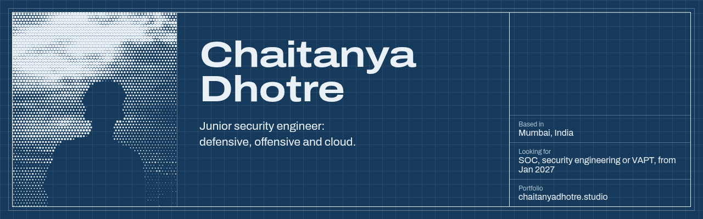

I build security tools end to end: the detection logic, the cryptography, the guard rails, and an honest write-up of what didn't work. I'm finishing a BSc (Hons) in Cyber Security and Networking at the University of Lancashire and interned at CyArt Tech LLP, where I built and ran a data-collection pipeline for a threat-intelligence platform.

Looking for a SOC, security-engineering or VAPT role in India from January 2027. Portfolio: [chaitanyadhotre.dev](https://chaitanyadhotre.dev)

## Projects

| Project | What it is | Built with |
|---|---|---|
| [**RogueAP Shield**](https://github.com/chaitanya-dhotre/RogueAP-Shield) | Windows service that detects evil-twin Wi-Fi with 7 signals and triggers a VPN kill switch | C#, .NET 9, WPF, Windows Filtering Platform |
| [**Kuch Bhi**](https://github.com/chaitanya-dhotre/kuch_bhi) | End-to-end encrypted messenger with a self-hosted, hardened Oracle Cloud backend | Flutter, X25519 + AES-256-GCM, PocketBase, Tailscale |
| [**RiskGate**](https://chaitanyadhotre.dev/work/riskgate/) *(code private until assessed)* | Risk-adaptive, human-approved, time-bound access elevation for AWS, driven by CloudTrail behaviour and attack paths | Python, FastAPI, AWS STS/IAM, CloudTrail |

## Toolbox

- **Defensive:** log analysis, Wireshark, digital forensics (FTK Imager, Autopsy, KAPE, memory capture); Microsoft Sentinel, Defender and KQL (learning for SC-200)
- **Offensive:** Nmap, Burp Suite, Metasploit, SQLMap, Wi-Fi attacks (evil twin), Windows privilege escalation
- **Cloud:** AWS IAM, STS, CloudTrail; Oracle Cloud; Azure (learning)
- **Code:** Python, C#/.NET, TypeScript, Dart/Flutter, SQL, Bash, Git

## Certifications

- Done: EC-Council NSTDM (completion certificate)
- Planned for 2027: Microsoft SC-200, CompTIA CySA+, TryHackMe SAL1 and PT1, ISC2 CC

[LinkedIn](https://www.linkedin.com/in/chaitanya-dhotre/) · [Email](mailto:chaitanyad301@proton.me) · [CV (PDF)](https://cv.chaitanyadhotre.dev/cv/Chaitanya_Dhotre_CV.pdf)
